# Hafta 3 – Ekstra Çalışma Soruları Çözümleri

| Şekil | Anlamı |
|---|---|
| Oval | Başla / Bitir |
| Paralelkenar `/ /` | Giriş (klavye) |
| Dikdörtgen | İşlem / Atama |
| Eşkenar dörtgen | Karar (Koşul) |
| Ters paralelkenar `\ \` | Çıkış (ekran) |

---

### 7) Girilen vize ve final notlarına göre öğrencinin dersten geçip geçmediğini bulan akış diyagramını tasarlayınız.

> Not: Ortalama = vize × %40 + final × %60, geçme notu 50 kabul edilmiştir.

**Algoritma**
1. Başla
2. vize, final gir
3. ort = vize * 0.4 + final * 0.6
4. Eğer ort >= 50 ise "Dersten geçti" yaz, değilse "Dersten kaldı" yaz
5. Bitir

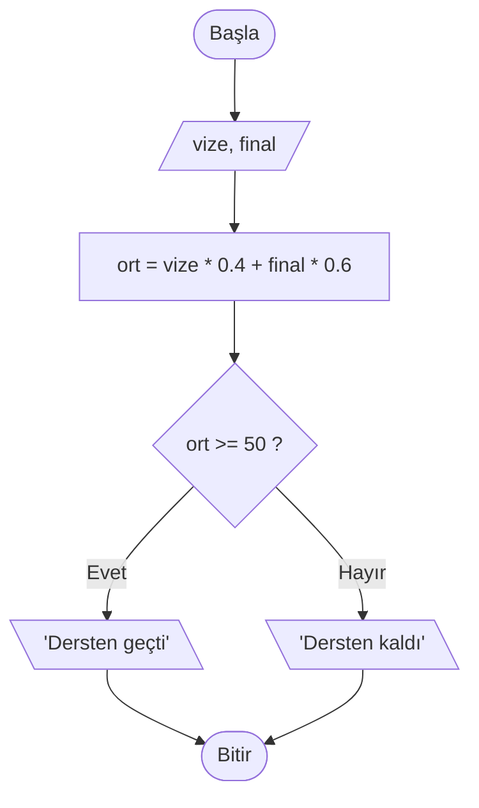

---

### 8) Klavyeden girilen Fahrenayt derecesini Santigrata çeviren programın akış şemasını çiziniz.

**Algoritma**
1. Başla
2. F gir
3. C = (F - 32) * 5 / 9
4. C yaz
5. Bitir

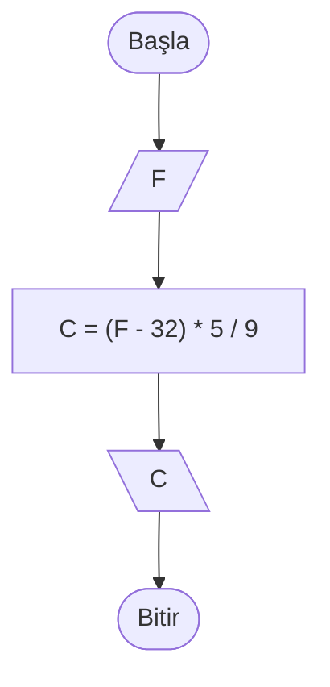

---

### 9) Bir öğrencinin almış olduğu vize notu ile final notunun ortalamasını hesaplayan algoritma ve akış şeması (Vize notunun %30'unu final notunun %70'ini alarak hesaplama yapınız) çiziniz.

**Algoritma**
1. Başla
2. vize, final gir
3. ort = vize * 0.3 + final * 0.7
4. ort yaz
5. Bitir

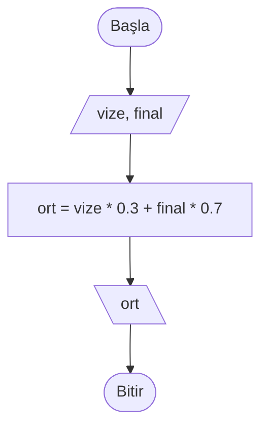

---

### 10) Yarıçapı girilen dairenin çevresini ve alanını hesaplayan algoritma ve akış şeması (pi sayısını 3.14 olarak alınız) çiziniz.

**Algoritma**
1. Başla
2. r gir
3. cevre = 2 * 3.14 * r
4. alan = 3.14 * r * r
5. cevre, alan yaz
6. Bitir

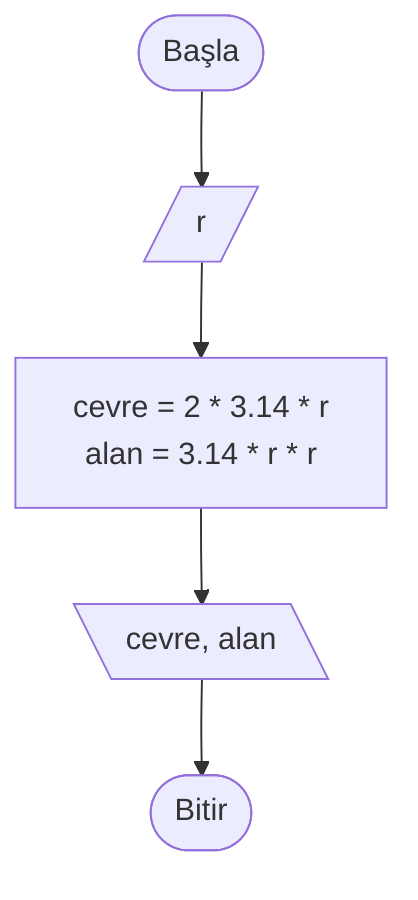

---

### 11) Girilen bir sayının mutlak değerini hesaplayan ve sonucu ekrana yazdıran algoritma ve akış şeması çiziniz.

**Algoritma**
1. Başla
2. x gir
3. Eğer x < 0 ise x = -x
4. x yaz
5. Bitir

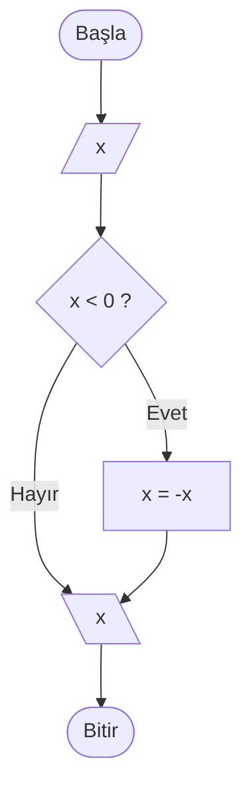

---

### 12) Girilen bir x sayısının yine girilen bir y sayısına tam bölünüp bölünmediğini ekrana yazdıran algoritma ve akış şeması çiziniz.

**Algoritma**
1. Başla
2. x, y gir
3. Eğer y == 0 ise "Sıfıra bölme yapılamaz" yaz, 6. adıma git
4. Eğer x % y == 0 ise "x, y'ye tam bölünür" yaz
5. Değilse "x, y'ye tam bölünmez" yaz
6. Bitir

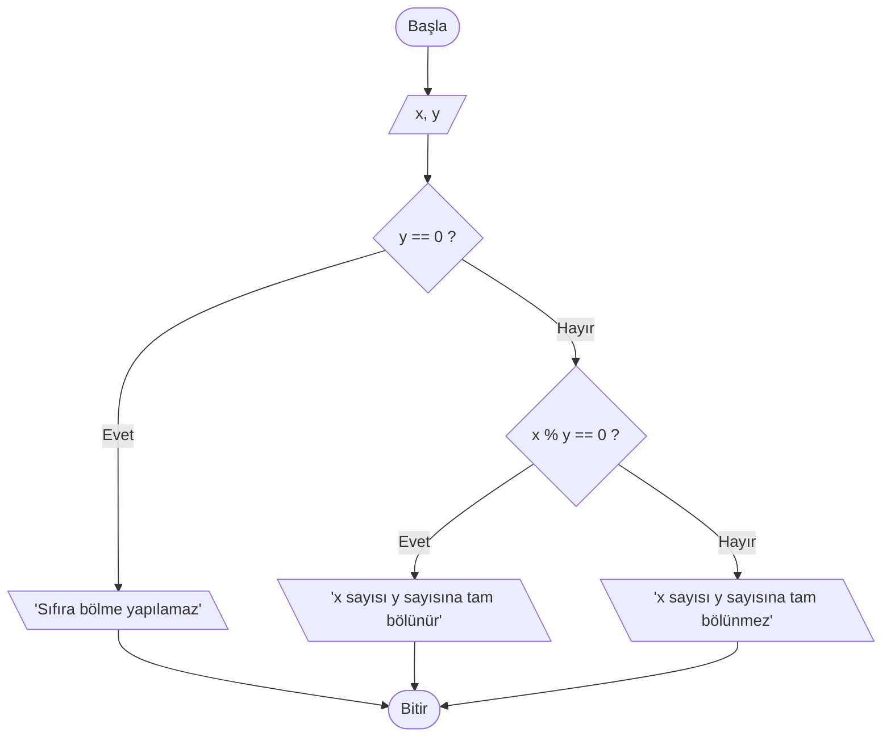

---

### 13) 1'den N'e kadar olan çift tamsayıların toplamını hesaplayan algoritma ve akış şeması çiziniz.

**Algoritma**
1. Başla
2. N gir
3. toplam = 0, i = 2
4. Eğer i <= N ise 5. adıma, değilse 7. adıma git
5. toplam = toplam + i
6. i = i + 2, 4. adıma git
7. toplam yaz
8. Bitir

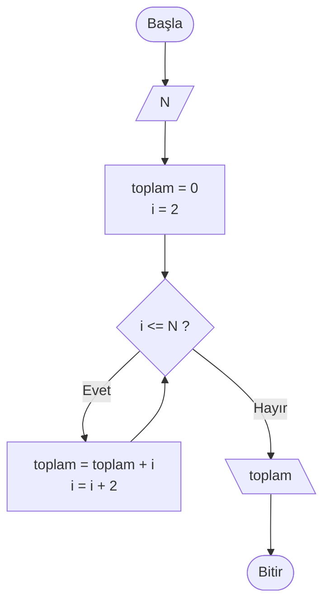

---

### 14) Kısa kenarı ve uzun kenarı girilen dikdörtgenin çevresini hesaplayan algoritma ve akış şeması çiziniz.

**Algoritma**
1. Başla
2. kisa, uzun gir
3. cevre = 2 * (kisa + uzun)
4. cevre yaz
5. Bitir

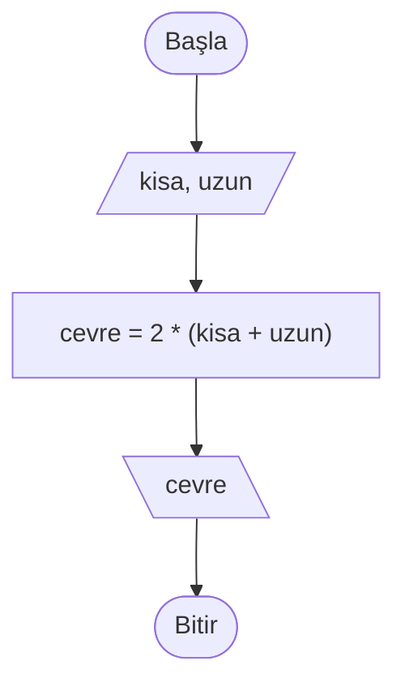

---

### 15) Kısa kenarı ve uzun kenarı girilen dikdörtgenin çevresini hesaplayan algoritma ve akış şeması çiziniz.

**Çözüm:** 14. soru ile aynıdır.

---

### 16) İki dik kenarı girilen dik üçgenin hipotenüsünü hesaplayan algoritma ve akış şeması (Pisagor Teoremi) çiziniz.

**Algoritma**
1. Başla
2. a, b gir
3. c = karekök(a * a + b * b)
4. c yaz
5. Bitir

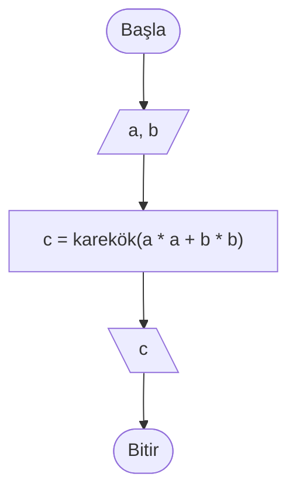

---

### 17) Döngü yaklaşımını kullanarak 2 üzeri 4'ü hesaplamak için bir algoritma yazın ve bir akış şeması çizin.

**Algoritma**
1. Başla
2. sonuc = 1, i = 1
3. Eğer i <= 4 ise 4. adıma, değilse 6. adıma git
4. sonuc = sonuc * 2
5. i = i + 1, 3. adıma git
6. sonuc yaz (16)
7. Bitir

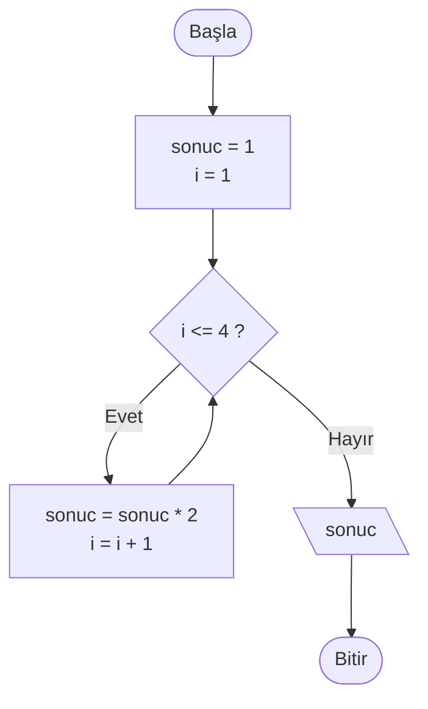

---

### 18) Artık yılı hesaplamak için bir akış diyagramı oluşturunuz.

**Algoritma**
1. Başla
2. yil gir
3. Eğer yil % 400 == 0 ise "Artık yıl" yaz, 6. adıma git
4. Eğer yil % 4 == 0 ve yil % 100 != 0 ise "Artık yıl" yaz
5. Değilse "Artık yıl değil" yaz
6. Bitir

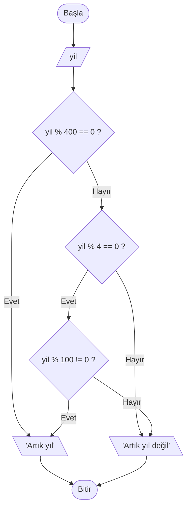

---

### 19) Boyu ile kilosu girilen kişinin şişman mı, zayıf mı yoksa ideal kiloda mı olduğunu gösteren programın akış diyagramını çiziniz.

> Not: VKİ = kilo / (boy × boy), boy metre cinsinden. 18.5 altı zayıf, 18.5 – 25 arası ideal, 25 ve üstü şişman.

**Algoritma**
1. Başla
2. boy, kilo gir
3. vki = kilo / (boy * boy)
4. Eğer vki < 18.5 ise "Zayıf" yaz
5. Değilse eğer vki < 25 ise "İdeal kilo" yaz
6. Değilse "Şişman" yaz
7. Bitir

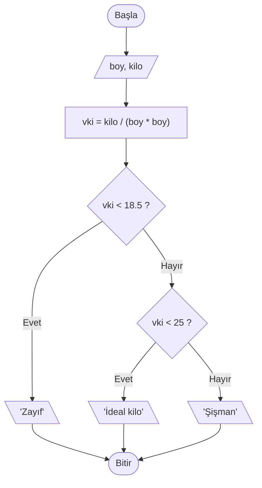

---

### 20) Kenarları A,B,C,D olan bir dörtgenin kare olup olmadığını bulan programın algoritma ve akış diyagramını çiziniz.

> Not: Dörtgenin açılarının 90° olduğu kabul edilmiştir; dört kenar eşitse karedir.

**Algoritma**
1. Başla
2. A, B, C, D gir
3. Eğer A == B ve B == C ve C == D ise "Karedir" yaz
4. Değilse "Kare değildir" yaz
5. Bitir

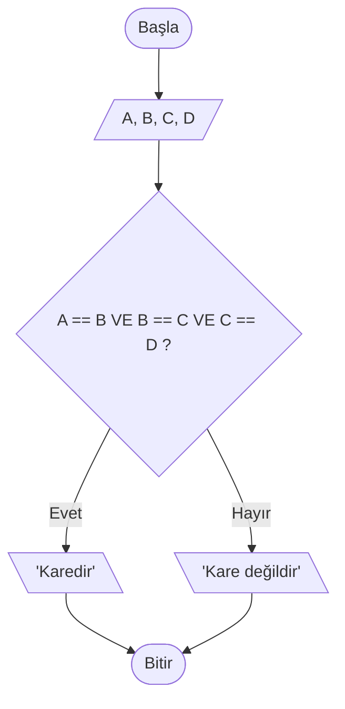

---

### 21) Girilen dört basamaklı sayılardan ilk iki basamağı ile son iki basamağının toplamının karesi, sayının kendine eşit olan sayılara orijinal sayı denir. Girilen sayının orijinal olup olmadığını bulan programın algoritma ve akış diyagramını çiziniz.

> Örnek: 2025 → (20 + 25)² = 45² = 2025 → orijinal. (`/` tam sayı bölmesidir.)

**Algoritma**
1. Başla
2. sayi gir
3. Eğer sayi < 1000 veya sayi > 9999 ise "Geçersiz sayı" yaz, 8. adıma git
4. ilk = sayi / 100
5. son = sayi % 100
6. kare = (ilk + son) * (ilk + son)
7. Eğer kare == sayi ise "Orijinal sayıdır" yaz, değilse "Orijinal sayı değildir" yaz
8. Bitir

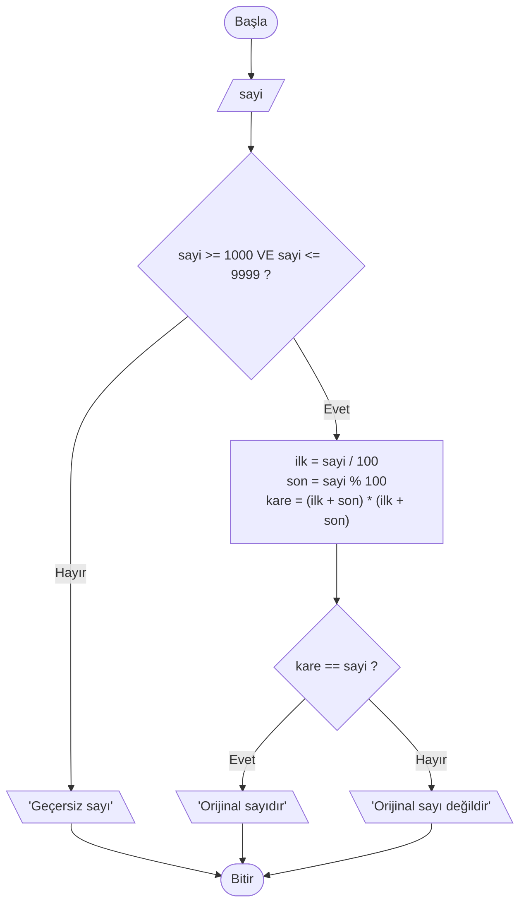

---

### 22) 4 haneli bir sayının birler, onlar, yüzler ve binler hanesini bulan programın algoritma ve akış diyagramını çiziniz.

> Örnek: 4725 → binler = 4, yüzler = 7, onlar = 2, birler = 5. (`/` tam sayı bölmesidir.)

**Algoritma**
1. Başla
2. sayi gir
3. binler = sayi / 1000
4. yuzler = (sayi / 100) % 10
5. onlar = (sayi / 10) % 10
6. birler = sayi % 10
7. binler, yuzler, onlar, birler yaz
8. Bitir

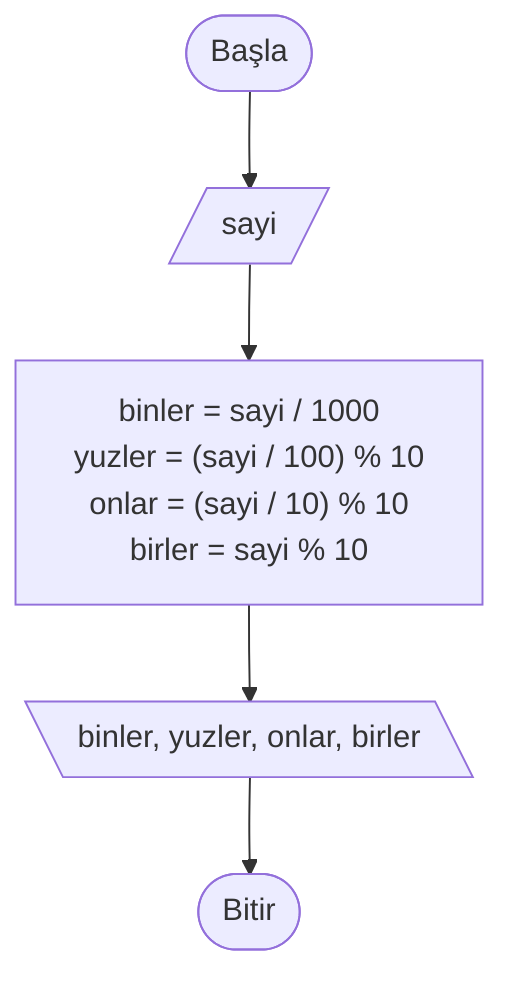

---

### 23) Rastgele girilen 50 sayıdan negatif olanların ve pozitif olanların sayısını bulan programın algoritma ve akış şemasını çiziniz.

**Algoritma**
1. Başla
2. negatif = 0, pozitif = 0, i = 1
3. Eğer i <= 50 ise 4. adıma, değilse 8. adıma git
4. x gir
5. Eğer x < 0 ise negatif = negatif + 1
6. Değilse eğer x > 0 ise pozitif = pozitif + 1
7. i = i + 1, 3. adıma git
8. negatif, pozitif yaz
9. Bitir

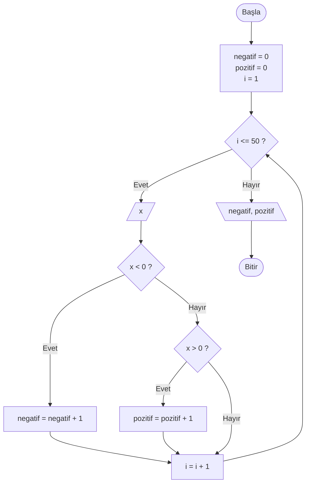

---

### 24) Sayı bulmaca oyunu programının algoritma ve akış diyagramı çiziniz.

> Not: Bilgisayar 1–100 arasında bir sayı tutar, kullanıcı bulana kadar tahmin eder.

**Algoritma**
1. Başla
2. gizli = 1–100 arası rastgele sayı, deneme = 0
3. tahmin gir
4. deneme = deneme + 1
5. Eğer tahmin == gizli ise "Tebrikler! Deneme sayısı:" deneme yaz, 8. adıma git
6. Eğer tahmin < gizli ise "Daha büyük bir sayı girin" yaz, 3. adıma git
7. Değilse "Daha küçük bir sayı girin" yaz, 3. adıma git
8. Bitir

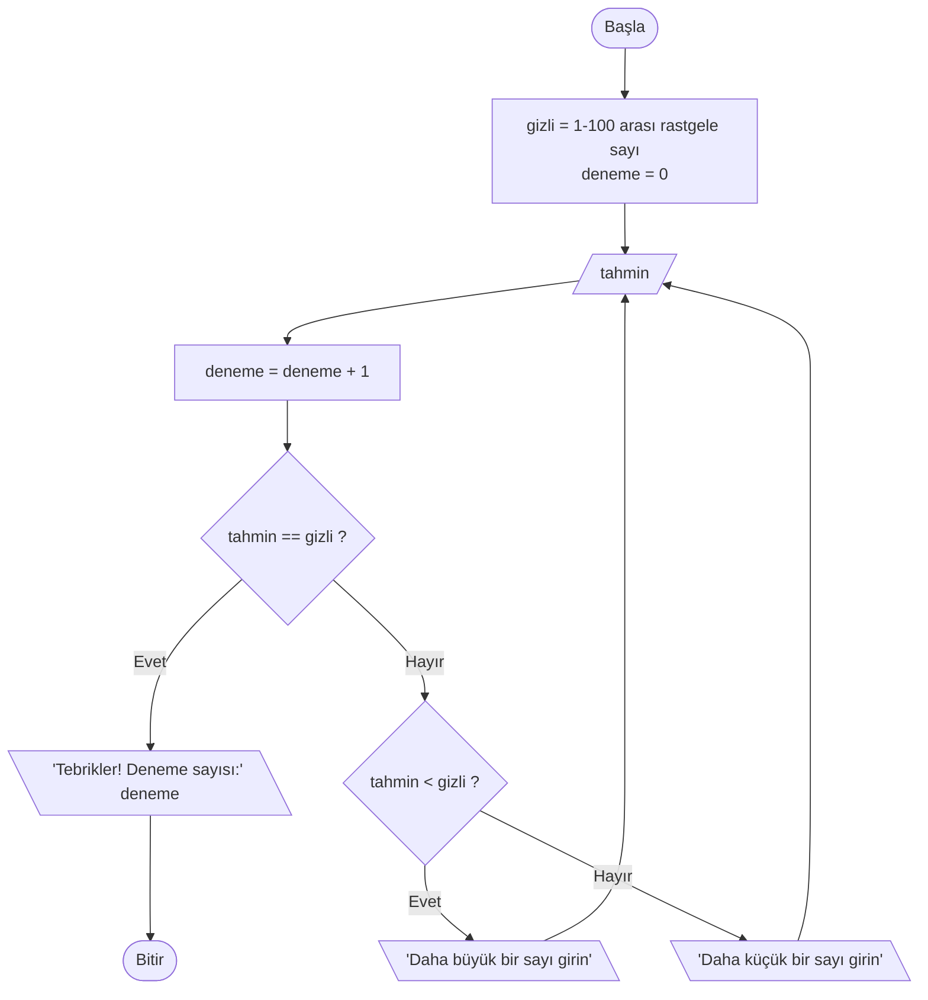

---

### 25) Binary olarak girilen sayıyı decimal sayıya çeviren programın algoritma ve akış diyagramını çiziniz.

> Örnek: 1011 → 1·8 + 0·4 + 1·2 + 1·1 = 11. (`/` tam sayı bölmesidir.)

**Algoritma**
1. Başla
2. binary gir
3. decimal = 0, basamak = 1
4. Eğer binary > 0 ise 5. adıma, değilse 9. adıma git
5. kalan = binary % 10
6. decimal = decimal + kalan * basamak
7. basamak = basamak * 2
8. binary = binary / 10, 4. adıma git
9. decimal yaz
10. Bitir

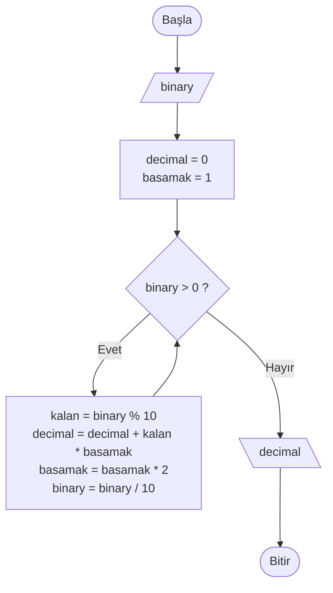

---

### 26) Dışarıdan iki dik kenarı girilen üçgenin hipotenüsünü hesaplayan programın algoritma ve akış diyagramını çiziniz.

**Çözüm:** 16. soru ile aynıdır.

---

### 27) Sıcaklık Değerine Göre Su Durumu

Kullanıcıdan suyun sıcaklık değerini (S) alan ve suyun KATI (Buz), SIVI veya GAZ (Buhar) durumunda olduğunu ekrana yazdıran akış şemasını çiziniz. (0 ve altı KATI, 100 ve üstü GAZ, arası SIVI kabul edilecektir).

**Algoritma**
1. Başla
2. S gir
3. Eğer S <= 0 ise "KATI (Buz)" yaz
4. Değilse eğer S >= 100 ise "GAZ (Buhar)" yaz
5. Değilse "SIVI" yaz
6. Bitir

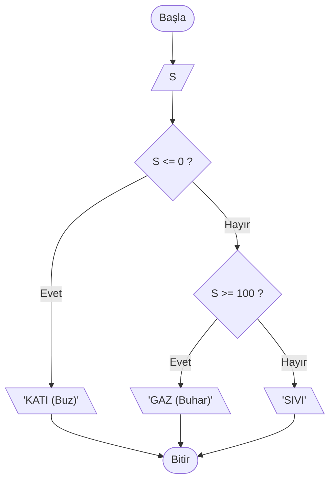

---

### 28) Ehliyet Yaşı ve Tutar Hesabı

Kullanıcıdan Yaş bilgisini alan bir sistem tasarlayınız.
- Eğer kullanıcının yaşı 18 ve üzeri ise ehliyet harcı olarak 1000 TL tutar belirlenip ekrana "Ehliyet alabilirsiniz. Ödenecek tutar: 1000 TL" yazılacaktır.
- Eğer yaşı 18'den küçük ise ekrana "Ehliyet alamazsınız" mesajı verilecektir.

**Algoritma**
1. Başla
2. yas gir
3. Eğer yas >= 18 ise tutar = 1000, "Ehliyet alabilirsiniz. Ödenecek tutar:" tutar "TL" yaz
4. Değilse "Ehliyet alamazsınız" yaz
5. Bitir

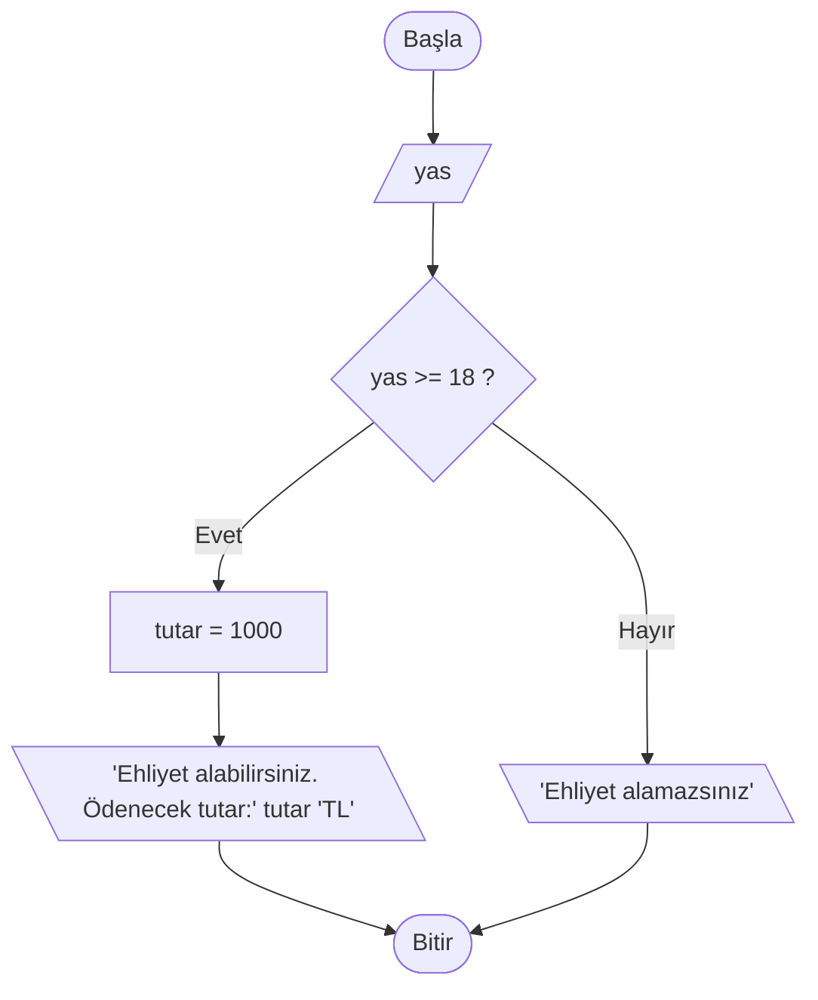

---

### 29) Sinema Bilet Fiyatı (İndirimli/Tam)

Bir sinemada tam bilet fiyatı 200 TL'dir.
- Öğrencilere %50 indirim uygulanmaktadır.
- Kullanıcıdan OgrenciMi bilgisi (1: Öğrenci, 0: Öğrenci Değil) alınacaktır.
- Buna göre ödenmesi gereken nihai bilet ücretini hesaplayıp ekrana yazdıran akış şemasını çiziniz.

**Algoritma**
1. Başla
2. fiyat = 200
3. OgrenciMi gir
4. Eğer OgrenciMi == 1 ise fiyat = fiyat - fiyat * 50 / 100
5. fiyat yaz
6. Bitir

```mermaid
flowchart TD
    A([Başla]) --> B["fiyat = 200"]
    B --> C[/"OgrenciMi"/]
    C --> D{"OgrenciMi == 1 ?"}
    D -->|Evet| E["fiyat = fiyat - fiyat * 50 / 100"]
    D -->|Hayır| F[\"fiyat"\]
    E --> F
    F --> G([Bitir])
```

---

### 30) İndirimli Alışveriş Tutar Hesaplama

Bir mağazada alışveriş tutarı 150 TL ve üzerinde ise toplam tutardan 30 TL indirim yapılmaktadır. 150 TL altında ise indirim uygulanmamaktadır. Alışveriş tutarını alıp ödenmesi gereken nihai tutarı hesaplayan akış şemasını çiziniz.

**Algoritma**
1. Başla
2. tutar gir
3. Eğer tutar >= 150 ise tutar = tutar - 30
4. tutar yaz
5. Bitir

```mermaid
flowchart TD
    A([Başla]) --> B[/"tutar"/]
    B --> C{"tutar >= 150 ?"}
    C -->|Evet| D["tutar = tutar - 30"]
    C -->|Hayır| E[\"tutar"\]
    D --> E
    E --> F([Bitir])
```

---

### 31) Sınavı Geçti/Kaldı Kontrolü (Devamsızlık Şartlı)

Bir öğrencinin dersten geçebilmesi için hem ortalamasının 50 veya üzeri hem de devamsızlığının 10 günden az olması gerekmektedir. Kullanıcıdan Ortalama ve Devamsizlik değerlerini alıp geçme/kalma durumunu belirleyen akış şemasını çiziniz.

**Algoritma**
1. Başla
2. Ortalama, Devamsizlik gir
3. Eğer Ortalama >= 50 ve Devamsizlik < 10 ise "GEÇTİ" yaz
4. Değilse "KALDI" yaz
5. Bitir

```mermaid
flowchart TD
    A([Başla]) --> B[/"Ortalama, Devamsizlik"/]
    B --> C{"Ortalama >= 50 VE Devamsizlik < 10 ?"}
    C -->|Evet| D[\"'GEÇTİ'"\]
    C -->|Hayır| E[\"'KALDI'"\]
    D --> F([Bitir])
    E --> F
```
